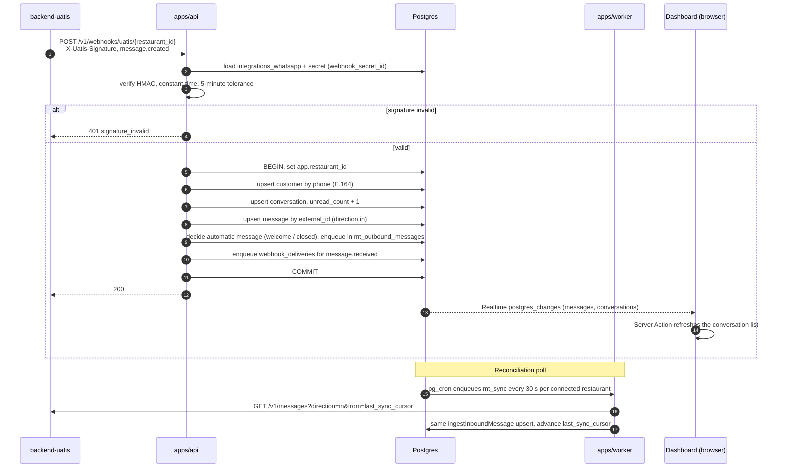
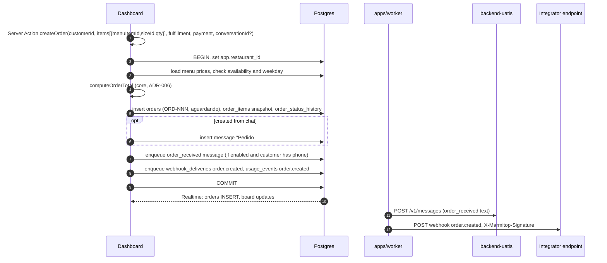
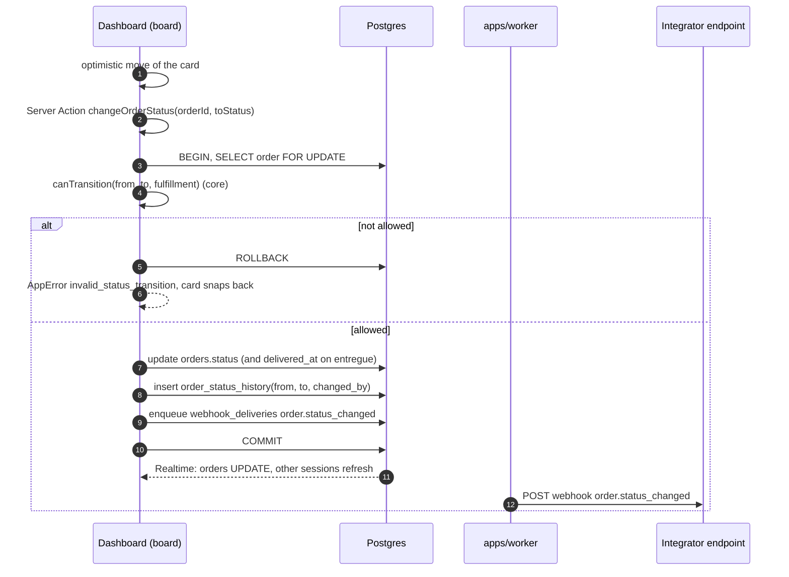

# 04. Architecture

This document defines the services, packages, data flow, and queue design of Marmitop v1. Decisions with tradeoffs live in `/docs/decisions/` as ADRs. This document states the chosen shape.

## System overview

```mermaid
flowchart LR
  subgraph Restaurant
    A[Admin / attendant\nbrowser]
    I[Integrator system]
  end
  subgraph Marmitop
    D[apps/dashboard\nNext.js 16 :3100]
    API[apps/api\nHono :3101]
    WK[apps/worker\nBun, health :8181]
    DB[(Supabase Postgres\nRLS + pgmq + pg_cron + Realtime)]
  end
  subgraph Sibling systems
    UA[backend-uatis\nWhatsApp API]
    NF[web-nf\ninvoice API]
  end
  A -->|pages, Server Actions| D
  D -->|@mt/http services in process, ADR-004| DB
  A <-->|Realtime postgres_changes| DB
  I -->|Bearer mtk_...| API
  UA -->|POST /v1/webhooks/uatis/id| API
  NF -->|POST /v1/webhooks/web-nf/id| API
  API --> DB
  WK -->|pgmq read| DB
  WK -->|POST /v1/messages\nGET /v1/messages| UA
  WK -->|POST /v1/invoices\nGET /v1/invoices/id| NF
  WK -->|signed webhooks| I
```

## Monorepo layout (ADR-001)

Turborepo with Bun workspaces. Package scope: `@mt/*`. Bun 1.3.x, Turbo, Biome, and `bun:test`.

```
apps/
  dashboard/   Next.js 16 App Router, Turbopack, shadcn/ui. Port 3100.
  api/         Hono. Public API and inbound webhooks. Port 3101.
  worker/      Bun process. Queue consumer and scheduler. Health on 8181.
packages/
  core/        Domain logic and ports. No I/O.
  db/          postgres.js client, RLS context wrapper, row types, queue helpers.
  schemas/     Zod schemas and shared error codes.
  http/        Services (one function per use case) and Hono middleware.
  ui/          shadcn/ui components.
  config/      tsconfig.base.json and the Biome config.
supabase/      config.toml, numbered migrations, seed.sql. Ports 54421 / 54422 / 54423.
scripts/       Local stack bootstrap and seed.
```

### Responsibility and allowed dependencies

| Unit | Responsibility | May depend on |
|---|---|---|
| `@mt/core` | `computeOrderTotal`, order status machine, business-hours logic, automatic-message rules, webhook signing and verification, `AppError`, port interfaces, in-memory fakes. | nothing internal |
| `@mt/schemas` | Zod schemas for API payloads, Server Action inputs, queue messages, and error codes. | `core` |
| `@mt/db` | Database client factories, the `withRestaurant(id, fn)` wrapper that sets `app.restaurant_id`, row types, pgmq helpers. | `core` |
| `@mt/http` | Services: `createOrder`, `changeOrderStatus`, `sendMessage`, `issueInvoice`, and so on. Hono middleware: API-key auth, restaurant binding, rate limit, idempotency, error mapping. Adapters: `UatisGateway`, `WebNfGateway`, `SecretBox`, `WebhookSender`. | `core`, `db`, `schemas` |
| `@mt/ui` | shadcn/ui components. | none (React only) |
| `@mt/config` | Shared tsconfig and Biome rules. | none |
| `apps/dashboard` | Pages, Server Actions, Supabase Auth session, Realtime subscriptions. Calls `@mt/http` services in process. | `core`, `db`, `schemas`, `http`, `ui` |
| `apps/api` | Public routes and inbound webhook routes. Thin Hono handlers over `@mt/http` services. | `core`, `db`, `schemas`, `http` |
| `apps/worker` | Reads pgmq queues, runs jobs, runs the scheduler, serves `/health`. | `core`, `db`, `schemas`, `http` |

Rules:

* `core` depends on nothing internal. Every other package may depend on `core`.
* An app never imports another app (web-nf rule). Shared code moves down into a package.
* Ports live in `core`. Adapters live in `http`. Tests inject fakes from `core`.
* No package imports `@mt/ui` except `apps/dashboard`.

## Runtime per app

| App | Runtime | Inbound traffic | Notes |
|---|---|---|---|
| `dashboard` | Node.js (Next.js 16, `next start`) in a container. | Browser HTTPS. | Holds `DATABASE_URL` and `MT_KEK`. The Supabase client is for Auth and Realtime only. The browser role `authenticated` has `select` only on `orders`, `messages`, and `conversations` (ADR-017). |
| `api` | Bun running Hono, in a container. | HTTPS from integrators, `backend-uatis`, `web-nf`. | Stateless. Scales horizontally. |
| `worker` | Bun long-running process, in a container. | Health endpoint only (`GET /health` on 8181). | One or more replicas. pgmq visibility timeouts prevent double work. |
| Database | Supabase Postgres with pgmq, pg_cron, Realtime. | Server processes use `app_service` (`nobypassrls`). | Local ports 54421 / 54422 / 54423. |

## Data access and live updates (ADR-004, ADR-005)

* Reads and writes in the dashboard go through Server Components and Server Actions. They call `@mt/http` services in process. The dashboard never calls `apps/api` over HTTP.
* Every Server Action resolves the caller's restaurant and role from `restaurant_members`. It never trusts ids sent by the client.
* Server processes connect as `app_service`, which does not bypass RLS. Each transaction runs `set local app.restaurant_id = '<uuid>'`. Policies use `mt.is_member(restaurant_id)` and `mt.is_admin(restaurant_id)` for user sessions, and `app.restaurant_id` for `app_service`.
* No `service_role` key serves as a database credential.
* Live updates use Supabase Realtime `postgres_changes` on `orders`, `messages`, and `conversations` (added to the `supabase_realtime` publication). The browser subscribes with the user's session. RLS filters events. On an event, the client calls a Server Action to refresh the affected data.
* Routes: `/login`, `/messages`, `/orders`, `/new-order`, `/contacts`, `/menu`, `/stock`, `/reports`, `/settings`.

## Data flows

### 1. Inbound WhatsApp message (FR-100–119)

`backend-uatis` delivers `message.created` to `apps/api`. A reconciliation poll covers lost webhooks. Both paths call the same `ingestInboundMessage` service. That service upserts by `messages.external_id`, so a message that arrives twice creates one row.



Automatic message rules (`core`):

* **welcome:** the conversation is new (first contact) and the `welcome` message is enabled.
* **closed:** the restaurant is outside business hours in `restaurant_settings.timezone` and the `closed` message is enabled. The service sends `closed` at most once per conversation per closed period.
* If both match, the service sends `closed` only.
* The automatic message becomes a `messages` row (direction `out`, `sent_by` null) and an `mt_outbound_messages` job in the same transaction as the inbound message.

### 2. Attendant reply (FR-014)

```mermaid
sequenceDiagram
  autonumber
  participant D as Dashboard
  participant DB as Postgres
  participant WK as apps/worker
  participant UA as backend-uatis
  participant API as apps/api

  D->>D: Server Action sendMessage(conversationId, body)
  D->>DB: BEGIN: check role, check the 24-hour window from conversations.last_inbound_at (outside: 422 outside_service_window, nothing stored; ADR-014), insert messages (out, pending), update conversation preview, enqueue mt_outbound_messages, usage_events message.sent, COMMIT
  DB-->>D: Realtime: message appears as pending
  WK->>DB: pgmq read mt_outbound_messages
  WK->>UA: POST /v1/messages {to, from_address, text} Bearer obk_...
  alt 201
    UA-->>WK: id, status pending
    WK->>DB: set external_id, status sent
  else 422 outside_service_window / whatsapp_disconnected
    WK->>DB: status failed, error recorded, no retry
  else connection error before the request left
    WK->>DB: record attempt, retry with backoff
  else timeout or 5xx after the request left
    WK->>DB: status failed, error_code ambiguous, no retry (ADR-017)
  end
  UA->>API: message.updated (delivered / read)
  Note over UA,DB: apps/api verifies and updates messages.status by external_id
  DB-->>D: Realtime: status change
```

### 3. Order from chat or counter (FR-020, FR-030–039)



If `restaurant_settings` has auto-accept on, the same transaction also moves the order to `confirmado` and writes a second history row.

### 4. Drag status change (FR-021, FR-022)



Transition rules (`core`): `aguardando → confirmado → preparando → pronto → saiu → entregue`. Pickup orders skip `saiu` (`pronto → entregue`). One step backward is allowed. `entregue` and `cancelado` are final. Any non-final status can move to `cancelado`.

### 5. Issue invoice through web-nf (FR-120–139)

```mermaid
sequenceDiagram
  autonumber
  participant D as Dashboard
  participant DB as Postgres
  participant WK as apps/worker
  participant NF as web-nf
  participant API as apps/api

  D->>D: Server Action issueInvoice(orderId, kind nfce|nfe)
  D->>DB: BEGIN: check order state and fiscal config, insert order_invoices (queued), enqueue mt_invoice_jobs, COMMIT
  WK->>DB: pgmq read mt_invoice_jobs
  WK->>WK: map order to payload (08.fiscal-mapping.md)
  WK->>NF: POST /v1/invoices Idempotency-Key = order_invoices.id
  NF-->>WK: 202 {id, status queued}
  WK->>DB: set external_id, status queued; enqueue mt_invoice_jobs poll in 30 s
  NF->>API: POST /v1/webhooks/web-nf/{restaurant_id}<br/>X-NF-Signature, invoice.authorized
  API->>API: verify HMAC, 5-minute tolerance
  API->>DB: update order_invoices by external_id (status, numero, serie, chave_acesso)
  API->>DB: enqueue webhook_deliveries invoice.updated, usage_events invoice.issued
  DB-->>D: Realtime refresh of the order panel
  Note over WK,NF: Poll fallback while status is not final
  WK->>NF: GET /v1/invoices/{external_id}
  WK->>DB: same update as the webhook path
  D->>D: Server Action getInvoiceFiles(orderInvoiceId)
  D->>NF: (server side) GET /v1/invoices/{external_id}
  NF-->>D: files.xml, files.pdf (short-lived signed URLs)
  D-->>D: returns URLs to the browser, never stores them
```

## Queue design (ADR-007)

pgmq inside the Supabase Postgres. No external broker.

| Queue | Message | Producer | Consumer action |
|---|---|---|---|
| `mt_outbound_messages` | `{ v, restaurantId, messageId }` | dashboard services, `apps/api` ingest (automatic messages) | `POST /v1/messages` on backend-uatis. |
| `mt_webhook_deliveries` | `{ v, restaurantId, deliveryId }` | services that emit domain events | `POST` to the restaurant's webhook endpoint. |
| `mt_invoice_jobs` | `{ v, restaurantId, orderInvoiceId, op }` (`op`: `issue`, `poll`, or `cancel`) | `issueInvoice`, the poll schedule, `cancelInvoice` | `POST /v1/invoices`, `GET /v1/invoices/{id}`, or `POST /v1/invoices/{id}/events` on web-nf. |
| `mt_sync` | `{ v, restaurantId, op: 'whatsapp_reconcile' }` | pg_cron | WhatsApp reconciliation poll. Invoice polls use `mt_invoice_jobs` with `op: 'poll'`. |

* Wire shapes are defined once, in `@mt/schemas`, with camelCase keys. `restaurantId` lets the worker set the RLS context before it reads the row.
* Producers enqueue in the same transaction as the event (outbox behavior). No event is lost, and no job exists for a rolled-back event.
* Every queue is idempotent except `mt_outbound_messages`, which is at-most-once once the request has left, because `backend-uatis` `POST /v1/messages` takes no idempotency key (ADR-017). Every other job is idempotent. The worker re-reads the row before the call. A message with `external_id` set is not sent again. An invoice with `external_id` set is polled, not re-posted.
* Retry backoff: 1 m, 5 m, 30 m, 2 h, 8 h. The consumer re-sends with `pgmq.send(queue, msg, delay)` and archives the failed message. After the last attempt, the row gets status `failed` (messages) or `exhausted` (webhook deliveries). Every attempt writes a `job_attempts` row.
* A permanent error from the remote system (`422 outside_service_window`, `422 validation_failed`) skips retries. So does an ambiguous outbound send (timeout or `5xx` after the request left): the message is `failed` with `error_code = ambiguous` and the attendant resends by hand.
* pg_cron jobs: reconciliation enqueue (every 30 s per connected restaurant), stuck-job reaper (every minute), retention of `job_attempts` and `webhook_deliveries` (daily).
* Visibility timeout: 60 s. It exceeds the 10 s HTTP timeout times the batch size. A handler can ask for more (the reconciliation poll uses 300 s).
* At-most-once send: the `mt_outbound_messages` handler sets `messages.send_claimed_at` in a committed transaction before `POST /v1/messages`. A claimed message is never sent again by the worker; a second read marks it `failed` / `ambiguous`. Only a connection error before the request left clears the claim and retries (migration 0015).
* A retried job carries `attempt` (2 to 6). The framework re-sends `{ ...payload, attempt + 1 }` with the delay and archives the old message.

### Worker framework (apps/worker/src/framework)

* `types.ts` — the `JobHandler<P>` contract: `queue`, optional `op` (matched against `payload.op`), a Zod `schema`, `subjectType` and `subjectId` for `job_attempts`, optional `visibilityTimeoutSeconds`, `run(ctx) → { kind: "ok" } | { kind: "retry", errorCode } | { kind: "fail", errorCode }`, and optional `onExhausted`. `QueueClient` is the pgmq port.
* `registry.ts` — `HandlerRegistry`, keyed by queue and op. The queue's visibility timeout is the largest of its handlers.
* `worker.ts` — `QueueWorker`: one poll loop per registered queue, `pgmq.read` in batches, a semaphore shared by all queues (`MT_WORKER_CONCURRENCY`), the retry schedule from `@mt/core` `decideAfterFailure`, one `job_attempts` row per attempt, archive on success and on final failure, graceful `stop()`. A thrown error is a transient `internal_error`. An invalid payload or a payload with no handler is archived with a log line and no attempt row.
* `pgmq-client.ts` — `PgmqQueueClient`: `complete` writes the attempt row, enqueues the retry, and archives the message in one transaction under the job's `system` context.
* Handlers live in `apps/worker/src/handlers/` with their store ports; the Postgres stores live in `apps/worker/src/stores/`. `apps/worker/src/registry.ts` registers them.

To add a handler (P6 invoices, P7 webhook deliveries): write `handlers/<name>.ts` that returns a `JobHandler` for the queue and op, with a store port so its tests run on fakes; write the Postgres store in `stores/`; add one `.register(...)` line in `src/registry.ts`. Health: `GET /health` on `WORKER_HEALTH_PORT` returns the worker state (200 running, 503 stopping).

### api layout (apps/api/src)

`app.ts` builds the Hono app from `ApiDeps` (`http/types.ts`) and maps errors with `@mt/http` `mapError`. `routes/index.ts` mounts one file per group: `routes/health.ts`, `routes/webhooks/uatis.ts` (P5). P6 adds `routes/webhooks/web-nf.ts`; P7 adds `routes/public/*.ts` behind the API-key middleware, and each adds its dependency to `ApiDeps`. Inbound webhook routes read the raw body with a 256 KB cap (`http/raw-body.ts`) and pass the bytes to a service in `@mt/http` (for uatis, `receiveUatisWebhook` with a store port).

## External dependencies behind ports

| Port (in `core`) | Real adapter (in `http`) | Fake (in `core`) |
|---|---|---|
| `WhatsAppGateway` | `UatisGateway` (HTTP to backend-uatis) | `FakeGateway`, also drives the dev-only "Simulate customer message" control |
| `InvoiceGateway` | `WebNfGateway` (HTTP to web-nf) | `FakeInvoiceGateway` |
| `BillingProvider` | `NullBillingProvider` (ADR-008) | recording fake |
| `Clock` | system clock | fixed clock |
| `SecretBox` | AES-256-GCM envelope encryption with `MT_KEK` (ADR-012) | in-memory map |
| `WebhookSender` | signed `fetch` with 10 s timeout, no redirects, SSRF guard (ADR-009) | recording fake |

Port methods (code in `packages/core/src/ports/`):

* `WhatsAppGateway`: `sendText({ to, fromAddress, body }) → { externalId, status }`, `sendTemplate({ to, fromAddress, templateName, language }) → { externalId, status }` (ADR-014), `listMessages({ from?, direction?, cursor?, limit? }) → { items, nextCursor }` (items use the internal `GatewayMessage` shape from `uatis-mapping.ts`), `listApprovedTemplates() → [{ name, language }]` (Settings picker), and `testConnection() → { ok } | { ok: false, error }` (FR-086).
* `InvoiceGateway`: `createInvoice(payload, idempotencyKey) → { id, status, replayed }`, `getInvoice(id) → InvoiceView`, `cancelInvoice(id, justificativa, idempotencyKey) → { status }` (a new key per cancel, 08 section 6.2), and `testConnection()` (FR-091).
* `BillingProvider`: `getPlan(restaurantId)`, `listInvoices(restaurantId)`, `recordUsage({ restaurantId, kind, refId, occurredAt })`.
* `Clock`: `now()`.
* `SecretBox`: `seal(plaintext, { restaurantId, secretId, kind }) → { ciphertext, iv, wrappedKey, kekVersion, last4 }`, `open(sealed, context) → plaintext`. The context is the AAD (`secret:v1:{restaurant_id}:{secret_id}:{kind}`). `EnvelopeSecretBox` also has `rewrap` for KEK rotation (07). `FakeSecretBox` is the in-memory fake.
* `WebhookSender`: `send({ url, secret, event, deliveryId, body }) → { statusCode }`, where `body` is the exact string that gets signed and sent.

Every adapter reports a failure as `GatewayError`. Kinds: `connection_error` (the request never left), `network_error` (the connection broke after the request may have left), `timeout`, `refused` (the SSRF guard or a bad URL stopped it before it left), and `http`. `retry-schedule.ts` classifies it as transient, permanent, or ambiguous (ADR-017). For a send, `timeout`, `network_error`, a `5xx`, and an unreadable `2xx` are ambiguous; `connection_error` and `429` are transient; `refused` and other `4xx` are permanent.

Adapters live in `packages/http/src/adapters/` (P5 choice: no new package). `safe-fetch.ts` is the only HTTP client for admin-entered URLs. It uses `node:http`/`node:https` with a `lookup` hook that resolves the name, refuses any blocked address, and hands the checked address to the socket, so no second DNS answer is used (07.security.md step 3). `uatis-gateway.ts` is `UatisGateway`. The `WhatsAppGateway` port keeps `listMessages`; the poll walks its pages (no separate `listInboundSince` method). `createServiceDeps` returns `UatisGateway` unless `MT_UATIS_FAKE=1`. The worker and the api build it per restaurant from `integrations_whatsapp` and the unsealed `secrets`. Contract suites for each port sit in `@mt/core/contracts` (they import `bun:test`, so only tests import them).

Money in `core` is a safe-integer `number` of cents. The database column is `bigint`, and `packages/db` converts at the edge (NFR-041).

## Error model

`@mt/core` defines `AppError(code, message, details[])`. Services throw it. Each caller maps it:

* `apps/api` maps `AppError` to the HTTP error envelope (see `06.api-spec.md`).
* Server Actions return `{ ok: false, error: { code, message, details } }`. They never throw to the browser.
* The worker maps `AppError` to retry or fail.

| Code | HTTP | Meaning |
|---|---|---|
| `unauthorized` | 401 | Missing or invalid credentials. |
| `forbidden` | 403 | Role or key scope is too low. |
| `not_found` | 404 | Resource missing, or it belongs to another restaurant. |
| `validation_failed` | 422 | Body or input invalid. `details[]` lists fields. |
| `conflict` | 409 | Unique violation, for example a duplicate phone. |
| `idempotency_conflict` | 409 | Same `Idempotency-Key`, different body. |
| `rate_limited` | 429 | Over the key's limit. |
| `signature_invalid` | 401 | Inbound webhook signature or timestamp failed. |
| `invalid_status_transition` | 422 | The order status machine refused the move. |
| `item_unavailable` | 422 | Menu item or size is unavailable, or not offered on this weekday. |
| `whatsapp_not_configured` | 422 | No `integrations_whatsapp` row, or status not connected. |
| `whatsapp_disconnected` | 422 | backend-uatis reports a disconnected line. |
| `outside_service_window` | 422 | The customer's last inbound message is older than 24 hours (ADR-014). The send service refuses before it stores anything. For `order_received` with no template, the worker records it on the message. |
| `fiscal_not_configured` | 422 | No `integrations_fiscal` row or missing defaults. |
| `invoice_not_allowed` | 422 | Order state does not allow an invoice. |
| `upstream_error` | 502 | backend-uatis or web-nf failed. The worker retries. |
| `internal_error` | 500 | Unexpected. The message never leaks internals. |

## Configuration

Each app reads its configuration from the environment at start. A missing required variable stops the process with a clear message. Secrets for third parties are not env vars. They live in the `secrets` table (ADR-012).

| Variable | dashboard | api | worker | Notes |
|---|---|---|---|---|
| `DATABASE_URL` | yes | yes | yes | `app_service` role. Local: port 54422. |
| `MT_KEK` | yes | yes | yes | 32 bytes, base64. |
| `MT_KEK_PREVIOUS` | yes | yes | yes | Old key, only during a KEK rotation (07). Unset otherwise. |
| `MT_KEK_VERSION` | yes | yes | yes | Version of `MT_KEK`, default 1. Stamped on new `secrets` rows. `MT_KEK_PREVIOUS` has version `MT_KEK_VERSION - 1` (07). |
| `SUPABASE_URL` | yes | yes | yes | Auth admin and JWT verification. Local: port 54421. |
| `SUPABASE_SERVICE_ROLE_KEY` | no | no | no | Not used. Never a database credential. |
| `NEXT_PUBLIC_SUPABASE_URL` | yes | no | no | Browser Auth and Realtime. |
| `NEXT_PUBLIC_SUPABASE_ANON_KEY` | yes | no | no | Browser Auth and Realtime. |
| `SUPABASE_JWT_SECRET` | yes | yes | no | Verifies HS256 session JWTs. Set this or `SUPABASE_JWT_JWKS`. |
| `SUPABASE_JWT_JWKS` | yes | yes | no | Public key set for ES256 and RS256 session JWTs. |
| `MT_PUBLIC_URL` | yes | yes | no | Public base URL of `apps/api`. Settings registers the backend-uatis webhook at `MT_PUBLIC_URL/v1/webhooks/uatis/{restaurant_id}`; when it is public `https` on port 443 the webhook is `push`, otherwise `pull` (ADR-021, ADR-023, FR-172). |
| `MT_UATIS_PULL_SECONDS` | no | no | yes | Seconds between backend-uatis event-feed reads for a restaurant in pull mode, default 3, 1 to 60 (ADR-023, FR-174). |
| `PORT` | 3100 | 3101 | no | |
| `WORKER_HEALTH_PORT` | no | no | 8181 | Worker `GET /health`. |
| `MT_ENV` | yes | yes | yes | `development`, `test`, or `production`. Enables the simulate control in development. |
| `MT_ALLOW_PRIVATE_HOSTS` | yes | yes | yes | `1` turns off the SSRF guard's private-host check and allows `http:` (local development only, ADR-017). The api and worker refuse to start with it set when `MT_ENV=production`. |
| `MT_LOG_LEVEL` | yes | yes | yes | Default `info`. |
| `MT_WORKER_CONCURRENCY` | no | no | yes | Default 4. |
| `MT_UATIS_FAKE` | yes | yes | yes | `1` selects `FakeGateway` (development and tests). |
| `MT_WEBNF_FAKE` | yes | yes | yes | `1` selects `FakeInvoiceGateway`. |

Per-restaurant values (base URLs, API keys, webhook secrets, `phone_number_id`, series, fiscal defaults) live in `integrations_whatsapp`, `integrations_fiscal`, and `secrets`.

## Multi-tenancy and environments

* Every tenant table has `restaurant_id` and RLS (NFR-001). Tests prove RLS holds when the service layer is bypassed.
* `mtk_test_` and `mtk_live_` keys behave the same: same restaurant data, same gateways. Real or fake gateways come from deployment config only (`MT_UATIS_FAKE`, `MT_WEBNF_FAKE`; ADR-017, `06.api-spec.md`). The restaurant's fiscal `environment` (`homologacao` or `producao`) decides which web-nf key it uses.
* No environment name appears in business logic. Configuration decides.
