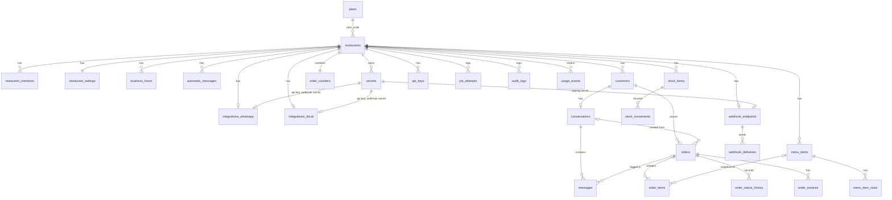

# 05. Data model

Postgres (Supabase). Every tenant table has `restaurant_id uuid not null` and RLS that is enabled and forced. Tables live in schema `public`. Helper functions live in schema `mt`. Migrations live in `supabase/migrations/` and run in order. They are forward-only: a change to an applied migration is a new migration, never an edit (11.operations.md).

Conventions:

* Money is `bigint` cents, never `numeric` and never `float` (ADR-006). Column names end in `_cents`.
* Timestamps are `timestamptz`. The restaurant's local day comes from `restaurant_settings.timezone` (default `America/Sao_Paulo`).
* Enum values are lowercase `text` with a `check` constraint, not Postgres enums. A new value is one migration that replaces the check.
* Primary keys are `uuid default gen_random_uuid()`.
* Every tenant table has a foreign key `restaurant_id → restaurants(id) on delete cascade`.
* Every foreign key from one tenant table to another is composite: `(restaurant_id, parent_id) → parent(restaurant_id, id)`, and each parent has `unique (restaurant_id, id)` (ADR-018). A child can never point at another restaurant's row, whatever the service does. A key with `on delete set null` names its column, for example `set null (conversation_id)`. The column tables below write these keys as "fk `parent(id)`" for short.
* Weekdays are `smallint` 0–6, where 0 is Sunday. This is the value of `extract(dow from …)`.
* Tables with `updated_at` have the trigger `mt.set_updated_at()`.

## Access model (ADR-004, ADR-005)

Three Postgres roles touch the data:

| Role | Who connects | What it can do |
|---|---|---|
| `app_service` | `apps/api`, `apps/worker`, the dashboard server (`DATABASE_URL`) | All reads and writes. `nobypassrls`, so every row passes a policy. |
| `authenticated` | The browser, with the anon key and the user's session JWT | `select` on `orders`, `messages`, and `conversations` only. It exists for Supabase Realtime (ADR-004). It holds no write grant on any table. |
| `anon` | The browser before login | Nothing. |

No process uses the Supabase `service_role` key as a database credential. Migration 0001 removes the Supabase default privileges that would grant `anon`, `authenticated`, and `service_role` every new table in `public`, and each table migration revokes them again explicitly. `service_role` therefore holds no grant on Marmitop tables.

### Why `authenticated` holds no write grant

The dashboard reads and writes through `@mt/http` services on `app_service` (ADR-004). The browser still holds the anon key and a session JWT, so it can call PostgREST directly. Any write grant to `authenticated` would let a browser skip the service layer. It could set `orders.total_cents` by hand or move an order from `aguardando` to `entregue`. So `authenticated` gets `select` on the Realtime tables and nothing else: `orders`, `messages`, `conversations`, and the status columns of `order_invoices` (migration 0017). A grant decides which tables and columns a role reaches. A policy decides which rows. The `authenticated` boundary needs both, as in web-nf migration 0016.

### Service context

Every service transaction starts with `mt.set_context(...)`, which runs `set_config(..., true)` (transaction-local) for four settings:

| Setting | Value | Set by |
|---|---|---|
| `app.restaurant_id` | the tenant | always |
| `app.actor_type` | `user`, `api_key`, or `system` | always |
| `app.user_id` | `auth.users.id` | dashboard server, for `user` actors |
| `app.api_key_id` | `api_keys.id` | `apps/api`, for `api_key` actors |

`packages/db` exposes `withRestaurantContext(ctx, fn)`. It opens the transaction, calls `mt.set_context`, and runs `fn`. No other code path opens a transaction on `app_service`. A missing setting reads as `null`, and every policy then matches zero rows. The system fails closed.

The worker and the inbound webhook routes use `actor_type = 'system'`. Worker jobs carry `restaurantId` in the queue message and set it before the first query. Inbound webhook routes take the restaurant id from the path, but they verify the signature before they write anything (07.security.md).

### Helper functions (schema `mt`)

All helpers use `set search_path = pg_catalog, pg_temp` and schema-qualified names. Each one is revoked from `public` and granted only to the roles listed.

| Function | Kind | Granted to | Returns |
|---|---|---|---|
| `mt.current_restaurant_id()` | `stable` | `app_service` | `app.restaurant_id` as uuid. Empty string folds to null. |
| `mt.current_user_id()` | `stable` | `app_service` | `app.user_id` as uuid, or null. |
| `mt.current_actor_type()` | `stable` | `app_service` | `app.actor_type`, or null. |
| `mt.set_context(restaurant_id, actor_type, user_id, api_key_id)` | volatile | `app_service` | Sets the four settings, transaction-local. Rejects an unknown `actor_type`. |
| `mt.actor_role()` | `stable`, `security definer` | `app_service` | `admin`, `attendant`, or null. See below. |
| `mt.can_write(min_role text)` | `stable` | `app_service` | `true` when `mt.actor_role()` meets `min_role`. |
| `mt.user_restaurant_ids()` | `stable`, `security definer` | `authenticated` | Restaurant ids where `auth.uid()` is a member. Definer so policies on `restaurant_members` do not recurse. |
| `mt.is_member(restaurant_id)` | `stable`, `security definer` | `authenticated`, `app_service` | Membership of `auth.uid()` (user path) or `app.user_id` (service path). |
| `mt.is_admin(restaurant_id)` | `stable`, `security definer` | `authenticated`, `app_service` | Same, with `role = 'admin'`. |
| `mt.memberships_for_user(user_id)` | `stable`, `security definer` | `app_service` | `(restaurant_id, role)` rows for one user. The dashboard calls it once per request, before the restaurant context exists. |
| `mt.api_key_lookup(hash)` | `stable`, `security definer` | `app_service` | `(id, restaurant_id, environment, revoked_at)` for one key hash, found through the unique index on `api_keys.hash` (ADR-017). The only way to resolve a restaurant from an API key. |
| `mt.next_order_code(restaurant_id)` | volatile, `security definer` | `app_service` | The next `ORD-NNN` code. See "Order code". Definer, because `order_counters` has no grant on any path. It raises unless `restaurant_id = mt.current_restaurant_id()` and `mt.can_write('attendant')`. |
| `mt.set_updated_at()` | trigger | — | Sets `new.updated_at = now()`. |
| `mt.touch_api_key(key_id)` | volatile, `security definer` | `app_service` | Sets `api_keys.last_used_at = now()` for a key of the current restaurant, at most once per 60 seconds per key. Returns whether it wrote. The only write an API key actor has into `api_keys` (ADR-018). |
| `mt.current_api_key_id()` | `stable` | `app_service` | `app.api_key_id` as uuid, or null. `mt.actor_role()` reads it. |
| `mt.order_transition_allowed(from, to, fulfillment)` | `immutable` | `app_service` | The "Allowed moves" table as a function. The transition trigger calls it. |
| `mt.check_order_subtotal(order_id)` | `security definer` | `app_service` | Raises `23514` when `subtotal_cents` differs from the items. The deferred subtotal triggers call it. |
| `mt.apply_tenant_policies(table, select, insert, update, delete, tenant_col)` | migration tooling | — (owner only) | Enables and forces RLS, revokes every grant, and creates the "Policy pattern" policies and grants for one table. |

`mt.actor_role()` resolves the role from data, never from a setting that code can write freely:

* `user`: the `role` of the `restaurant_members` row for `(app.restaurant_id, app.user_id)`. No row gives null.
* `api_key`: `attendant`, if the key in `app.api_key_id` belongs to `app.restaurant_id` and is not revoked. Otherwise null.
* `system`: `admin`.
* anything else: null.

`mt.can_write('attendant')` is true for `attendant` and `admin`. `mt.can_write('admin')` is true for `admin` only.

### Policy pattern

Each tenant table has one policy per command on `app_service`:

```sql
-- read: any member, any API key, the system
create policy <t>_service_select on public.<t> for select to app_service
  using (restaurant_id = mt.current_restaurant_id() and mt.actor_role() is not null);

-- write: role rule from the table below
create policy <t>_service_insert on public.<t> for insert to app_service
  with check (restaurant_id = mt.current_restaurant_id() and mt.can_write('<min_role>'));
-- update: same expression in both USING and WITH CHECK; delete: USING only
```

The service layer is authoritative for roles (ADR-005). These policies are the backstop: a service that forgets a role check still cannot write.

Tables used by Realtime also have:

```sql
create policy <t>_user_select on public.<t> for select to authenticated
  using (restaurant_id in (select mt.user_restaurant_ids()));
```

### Role rules

"Read" lists who passes the `select` policy on `app_service`. "Write" is the minimum role for `insert`, `update`, and `delete`. `—` means no grant exists for that command.

| Table | Read | Write | `authenticated` |
|---|---|---|---|
| restaurants | member | admin (update only) | — |
| restaurant_members | member | admin | — |
| restaurant_settings | member | admin | — |
| business_hours | member | admin | — |
| automatic_messages | member | admin | — |
| secrets | admin | admin | — |
| integrations_whatsapp | admin | admin | — |
| integrations_fiscal | member | admin | — |
| customers | member | attendant (insert, update; never deleted) | — |
| conversations | member | attendant (insert, update; never deleted) | select (member) |
| messages | member | attendant (insert, update; never deleted) | select (member) |
| menu_items | member | admin (insert, update; archived, never deleted) | — |
| menu_item_sizes | member | admin | — |
| orders | member | attendant (insert, update; never deleted); clearing `paid_at` admin (trigger) | select (member) |
| order_items | member | attendant (insert, update; never deleted) | — |
| order_status_history | member | attendant (insert only) | — |
| order_invoices | member | attendant (insert, update; never deleted); cancel request admin (trigger) | — |
| order_counters | — | attendant (via function) | — |
| stock_items | member | admin (insert, update; archived, never deleted) | — |
| stock_movements | member | admin (insert only) | — |
| api_keys | admin | admin | — |
| webhook_endpoints | member | admin | — |
| webhook_deliveries | admin | attendant (insert); admin (update, delete) | — |
| job_attempts | admin | admin (insert only) | — |
| idempotency_records | member | attendant | — |
| rate_counters | `app_service` (no tenant check) | `app_service` | — |
| audit_logs | admin | attendant (insert only) | — |
| usage_events | admin | attendant (insert only) | — |
| plans | everyone | — | — |

Notes:

* "member" in the Read column means any non-null `mt.actor_role()`, which includes API keys and the system.
* `restaurants` has no `insert` or `delete` on any path. A restaurant and its first admin are created together by the seed script or the onboarding service, which runs as a migration-owner function (`mt.create_restaurant(name, owner_user_id)`, `security definer`, granted to `app_service`).
* `integrations_fiscal` is member-readable because the attendant's "Emitir NF" screen needs the series and environment. It holds no secret values, only secret ids.
* `audit_logs` and `usage_events` accept inserts from attendants, because attendant actions produce audit rows and usage events. They have no `update` or `delete` grant for any role.
* An insert into a table that the caller may not read must not use `RETURNING` or `ON CONFLICT (<columns>)`. With a conflict target, Postgres also checks the new row against the SELECT policy, so an attendant or API-key insert into `usage_events` fails with `42501`. The usage insert therefore uses a bare `ON CONFLICT DO NOTHING` (P9 fix).
* `order_status_history`, `stock_movements`, and `job_attempts` are append-only: `select` and `insert` grants only.
* No role deletes `orders`, `order_items`, `order_invoices`, `messages`, `conversations`, `customers`, `menu_items`, or `stock_items` in v1 (ADR-018). The Realtime tables therefore never emit `DELETE` events. "Delete" on a menu item (FR-057) or a stock item sets `archived_at`. `menu_item_sizes` keeps an admin delete: sizes are edited with their item, and no row references a size.
* `webhook_endpoints` is member-readable and `webhook_deliveries` accepts inserts from attendants, because the order and message services that produce deliveries run as attendants and API keys. The endpoint row holds a secret id, never a secret value. Only admins (and the worker, as `system`) read or change deliveries.
* `stock_items.current_qty` is not in the `app_service` update grant. Only the movement trigger changes it.
* A column-level grant restricts `restaurants` updates on `app_service`: `plan_code` and `id` are not in the grant. Plan changes come from the billing adapter through a definer function (ADR-008).

## Tables

### plans

Platform-global. No `restaurant_id`.

| column | type | notes |
|---|---|---|
| code | text pk | `free`, `pro` (seeded) |
| name | text | display name |
| included_orders_month | int | `>= 0` |
| included_messages_month | int | `>= 0` |
| included_invoices_month | int | `>= 0` |
| price_display | text | display only. Nothing charges in v1 (ADR-008). |

RLS: `select using (true)` for `app_service`. No write grant. Migrations seed the rows.

### restaurants

| column | type | notes |
|---|---|---|
| id | uuid pk | |
| name | text not null | 1–120 characters |
| phone | text | display phone |
| email | text | |
| address | text | display line |
| cidade | text | |
| uf | text | `^[A-Z]{2}$` |
| codigo_municipio | text | IBGE code, `^[0-9]{7}$`. New customer and order addresses default to these three values (ADR-016). |
| plan_code | text not null default `'free'` | fk `plans(code)` |
| created_at, updated_at | timestamptz | |

Covers FR-080. Fiscal identity (CNPJ, IE, regime) lives in web-nf, not here. Marmitop only stores how to reach web-nf (`integrations_fiscal`).

### restaurant_members

| column | type | notes |
|---|---|---|
| id | uuid pk | |
| restaurant_id | uuid not null | fk |
| user_id | uuid not null | fk `auth.users(id) on delete cascade` |
| role | text not null | `admin` \| `attendant` |
| created_at | timestamptz | |

Unique `(restaurant_id, user_id)`. Index `(user_id)`. Covers FR-001–009.

A trigger refuses an `update` or `delete` that would leave a restaurant with no `admin`.

### restaurant_settings

One row per restaurant. Primary key `restaurant_id`.

| column | type | notes |
|---|---|---|
| restaurant_id | uuid pk | fk |
| auto_accept | boolean not null default false | new orders start as `confirmado` |
| allow_pickup | boolean not null default true | |
| show_delivery_estimate | boolean not null default true | |
| delivery_estimate_minutes | int not null default 45 | 5–240 |
| delivery_fee_cents | bigint not null default 0 | `>= 0`. Applies to delivery orders only (ADR-006). |
| timezone | text not null default `'America/Sao_Paulo'` | IANA name. Checked against `pg_timezone_names` by the service. |
| updated_at | timestamptz | |

Covers FR-080–089 (order preferences).

### business_hours

| column | type | notes |
|---|---|---|
| id | uuid pk | |
| restaurant_id | uuid not null | fk |
| weekday | smallint not null | 0–6, 0 = Sunday |
| enabled | boolean not null default true | |
| opens_at | time not null | local time in `restaurant_settings.timezone` |
| closes_at | time not null | `<> opens_at`. When `closes_at < opens_at`, the interval ends on the next day. |

Unique `(restaurant_id, weekday)`. One interval per day. `packages/core` `isOpenAt(hours, timezone, instant)` is the only reader that decides "open" or "closed".

### automatic_messages

| column | type | notes |
|---|---|---|
| id | uuid pk | |
| restaurant_id | uuid not null | fk |
| kind | text not null | `welcome` \| `closed` \| `order_received` |
| enabled | boolean not null default true | |
| body | text not null | 1–1000 characters. Sent as free text inside the 24-hour window. |
| template_name | text | approved `backend-uatis` template sent outside the window (ADR-014) |
| template_language | text | for example `pt_BR`. Set together with `template_name`. |
| updated_at | timestamptz | |

Unique `(restaurant_id, kind)`. Check `(template_name is null) = (template_language is null)`. The seed creates all three rows for each restaurant. Covers FR-100–119 (automatic messages).

### secrets

Envelope-encrypted values (ADR-012, 07.security.md).

| column | type | notes |
|---|---|---|
| id | uuid pk | |
| restaurant_id | uuid not null | fk |
| kind | text not null | `uatis_api_key` \| `uatis_webhook_secret` \| `webnf_api_key` \| `webnf_webhook_secret` \| `outbound_webhook_secret` |
| ciphertext | bytea not null | AES-256-GCM output, tag appended |
| iv | bytea not null | 12 bytes, `octet_length(iv) = 12` |
| wrapped_key | bytea not null | the data key encrypted under `MT_KEK`: `iv(12) ‖ ciphertext(32) ‖ tag(16)` |
| kek_version | smallint not null default 1 | which KEK wrapped the data key |
| last4 | text not null | last four characters of the plaintext, for display |
| created_at | timestamptz | |

Index `(restaurant_id, kind)`. `authenticated` holds no grant of any kind. On `app_service`, only `admin` and `system` actors pass the policies. Rows are never updated: `app_service` holds `select`, `insert`, and `delete` only. A rotation inserts a new row, points the owner row at it, and deletes the old row in the same transaction.

### integrations_whatsapp

One row per restaurant. Primary key `restaurant_id`. Covers FR-090–099, FR-100–119.

| column | type | notes |
|---|---|---|
| restaurant_id | uuid pk | fk |
| base_url | text not null | `backend-uatis` origin. `^https?://`. SSRF rules apply (07.security.md). |
| api_key_secret_id | uuid not null | fk `secrets(id) on delete restrict`, kind `uatis_api_key` |
| webhook_secret_id | uuid not null | fk `secrets(id) on delete restrict`, kind `uatis_webhook_secret` |
| phone_number_id | text not null | the sending number in `backend-uatis` |
| status | text not null default `'disconnected'` | `disconnected` \| `connected` \| `error` |
| last_error | text | last connection error, allow-listed text only |
| last_sync_cursor | timestamptz | newest `created_at` seen by the reconciliation poll. The next poll reads from this value minus 60 seconds (ADR-002 Amendment 1). |
| last_synced_at | timestamptz | |
| updated_at | timestamptz | |

A trigger checks that each `*_secret_id` points at a `secrets` row of the right `kind` and the same `restaurant_id`. The same trigger exists on `integrations_fiscal` and `webhook_endpoints`.

### integrations_fiscal

One row per restaurant. Primary key `restaurant_id`. Covers FR-090–099, FR-120–139.

| column | type | notes |
|---|---|---|
| restaurant_id | uuid pk | fk |
| base_url | text not null | `web-nf` origin. SSRF rules apply. |
| api_key_secret_id | uuid not null | fk `secrets`, kind `webnf_api_key` |
| webhook_secret_id | uuid not null | fk `secrets`, kind `webnf_webhook_secret` |
| environment | text not null default `'homologacao'` | `homologacao` \| `producao` |
| nfce_serie | int not null default 1 | 1–999 |
| nfe_serie | int not null default 1 | 1–999 |
| default_ncm | text not null | `^[0-9]{8}$` |
| default_cfop | text not null | `^[0-9]{4}$` |
| default_csosn | text | `^[0-9]{3}$` |
| default_pis_cst | text not null | `^[0-9]{2}$` |
| default_cofins_cst | text not null | `^[0-9]{2}$` |
| delivery_fee_mode | text not null default `'item'` | `item` \| `none`. With `item`, the delivery fee becomes an invoice line "Taxa de entrega" (ADR-016). |
| status | text not null default `'disconnected'` | `disconnected` \| `connected` \| `error` |
| last_error | text | |
| updated_at | timestamptz | |

08.fiscal-mapping.md describes how these defaults reach the web-nf payload.

### customers

| column | type | notes |
|---|---|---|
| id | uuid pk | |
| restaurant_id | uuid not null | fk |
| name | text not null | 1–120 characters |
| phone | text not null | E.164, `^\+[1-9][0-9]{7,14}$` |
| email | text | |
| cpf_cnpj | text | digits only, 11 or 14 digits. Optional. Required before an invoice for a delivery order (ADR-016). |
| cep | text | `^[0-9]{8}$` |
| logradouro | text | street |
| numero | text | `S/N` allowed |
| complemento | text | |
| bairro | text | |
| cidade | text | defaults to the restaurant's `cidade` |
| uf | text | `^[A-Z]{2}$`, defaults to the restaurant's `uf` |
| codigo_municipio | text | IBGE code, `^[0-9]{7}$`, defaults to the restaurant's `codigo_municipio` |
| notes | text | max 1000 characters |
| created_at, updated_at | timestamptz | |

The structured address replaces the free-text `address` and `neighborhood` (ADR-016). The UI builds one display line from the parts.

Unique `(restaurant_id, phone)`. Index `gin (name gin_trgm_ops)` for search (FR-040–049). Phone search uses the unique index with a prefix match on digits.

### conversations

| column | type | notes |
|---|---|---|
| id | uuid pk | |
| restaurant_id | uuid not null | fk |
| customer_id | uuid not null | fk `customers(id) on delete restrict` |
| external_id | text | `backend-uatis` conversation id |
| last_message_at | timestamptz | |
| last_message_preview | text | first 120 characters of the last message |
| unread_count | int not null default 0 | `>= 0` |
| last_inbound_at | timestamptz | `created_at` of the newest inbound message. The 24-hour window check reads it (ADR-014). |
| closed_notice_sent_at | timestamptz | when the `closed` automatic message was last sent. At most one in 12 hours (ADR-015). |
| created_at, updated_at | timestamptz | |

Unique `(restaurant_id, customer_id)`: one conversation per customer. Unique `(restaurant_id, external_id) where external_id is not null`. Index `(restaurant_id, last_message_at desc)` for the conversation list. In the Realtime publication. Covers FR-010–019.

### messages

| column | type | notes |
|---|---|---|
| id | uuid pk | |
| restaurant_id | uuid not null | fk |
| conversation_id | uuid not null | fk `conversations(id) on delete cascade` |
| direction | text not null | `in` \| `out` |
| body | text not null | 1–4096 characters (`backend-uatis` limit) |
| status | text not null | `pending` \| `sent` \| `delivered` \| `read` \| `failed` |
| external_id | text | `backend-uatis` message id |
| order_id | uuid | fk `orders(id) on delete set null`. The `Pedido #ORD-001` tag. |
| sent_by | uuid | fk `auth.users(id) on delete set null`. Null for inbound and automatic messages. |
| automatic_kind | text | `welcome` \| `closed` \| `order_received` for automatic messages, else null |
| template_name | text | set when the message went out as a template (ADR-014) |
| template_language | text | the template's language, for example `pt_BR`. Set together with `template_name` (migration 0015). |
| send_claimed_at | timestamptz | set by the `mt_outbound_messages` consumer, in a committed transaction, right before `POST /v1/messages`. A claimed message is never sent again by the worker (ADR-017 #4). A connection error before the request left clears it with the retry; a manual retry (FR-019) clears it too. |
| error_code | text | set when `status = 'failed'`, for example `outside_service_window` |
| error_message | text | allow-listed text, max 200 characters |
| created_at, updated_at | timestamptz | |

Constraints:

* Unique `(restaurant_id, external_id) where external_id is not null`. Inbound webhooks and the reconciliation poll upsert on this key, so a repeat delivery changes nothing.
* `check (direction = 'out' or sent_by is null)`.
* `check ((template_name is null) = (template_language is null))`.
* Inbound rows are inserted with `status = 'delivered'`. `backend-uatis` reports inbound messages as `received`; Marmitop stores that as `delivered` (ADR-002 Amendment 1).
* Inbound content that is not text is stored with the body `[mídia não suportada]`.

Status only moves forward: `pending → sent → delivered → read`, and `pending | sent → failed`. The upsert uses a rank comparison in its `where` clause, so an older event that arrives late never moves a status back.

Send retry semantics (ADR-017). `backend-uatis` `POST /v1/messages` takes no idempotency key, so the `mt_outbound_messages` consumer is at-most-once after the request leaves. Before the call it claims the row (`send_claimed_at`, see above) in its own transaction. A second read of the same job, after a crash or a visibility timeout, finds the claim and sets `failed` with `error_code = 'ambiguous'` instead of sending. A connection error before the request left is retried with the normal backoff. A timeout, or a 5xx after the request left, sets `status = 'failed'` and `error_code = 'ambiguous'`. The worker does not retry it. The attendant can resend by hand. A refusal with `outside_service_window` sets `failed` with that `error_code` and is not retried (ADR-014). The stuck-message sweep (`mt_reap_stuck_messages`) never resends.

Index `(restaurant_id, conversation_id, created_at desc)`. In the Realtime publication.

### menu_items

| column | type | notes |
|---|---|---|
| id | uuid pk | |
| restaurant_id | uuid not null | fk |
| kind | text not null | `meal` \| `drink` |
| name | text not null | 1–120 characters |
| description | text | max 500 characters |
| category | text not null | meal: `proteinas` `vegetariano` `fit` `executiva` `especial`; drink: `refrigerantes` `sucos` `agua` `alcoolicas` `quentes` |
| price_cents | bigint not null | `>= 0`. The price when the item has no sizes. |
| calories | int | meals only, `>= 0` |
| volume | text | drinks only, for example `350ml` |
| available | boolean not null default true | |
| popular | boolean not null default false | |
| available_weekdays | smallint[] not null default `'{0,1,2,3,4,5,6}'` | `<@ '{0,1,2,3,4,5,6}'` |
| image_url | text | public URL in bucket `menu-images` |
| archived_at | timestamptz | set by "Excluir" (FR-057). Archived items leave lists and cannot enter new orders. Order items keep their snapshot (ADR-018). |
| ncm | text | fiscal override, `^[0-9]{8}$` |
| cfop | text | fiscal override, `^[0-9]{4}$` |
| created_at, updated_at | timestamptz | |

A check pairs `category` with `kind`. A check rejects `calories` on drinks and `volume` on meals. Index `(restaurant_id, kind, category)`. Covers FR-050–059.

### menu_item_sizes

| column | type | notes |
|---|---|---|
| id | uuid pk | |
| restaurant_id | uuid not null | fk |
| menu_item_id | uuid not null | fk `menu_items(id) on delete cascade` |
| name | text not null | for example `P`, `M`, `G`, `Família` |
| price_cents | bigint not null | `>= 0` |
| position | smallint not null default 0 | display order |

Unique `(menu_item_id, name)`. When an item has sizes, a new order must name a size, and `menu_items.price_cents` is not used (ADR-006).

### order_counters

| column | type | notes |
|---|---|---|
| restaurant_id | uuid pk | fk |
| last_value | bigint not null default 0 | |

Holds the per-restaurant order number. See "Order code".

### orders

| column | type | notes |
|---|---|---|
| id | uuid pk | |
| restaurant_id | uuid not null | fk |
| code | text not null | `ORD-NNN` |
| customer_id | uuid not null | fk `customers(id) on delete restrict` |
| status | text not null | `aguardando` `confirmado` `preparando` `pronto` `saiu` `entregue` `cancelado` |
| fulfillment | text not null | `delivery` \| `pickup` |
| cep | text | `^[0-9]{8}$`. The address block is copied from the customer at order time and can be edited for this order. |
| logradouro | text | street |
| numero | text | `S/N` allowed |
| complemento | text | |
| bairro | text | |
| cidade | text | defaults to the restaurant's `cidade` |
| uf | text | `^[A-Z]{2}$`, defaults to the restaurant's `uf` |
| codigo_municipio | text | IBGE code, `^[0-9]{7}$`, defaults to the restaurant's `codigo_municipio` |
| payment_method | text not null | `pix` \| `dinheiro` \| `cartao_credito` \| `cartao_debito` |
| change_for_cents | bigint | `dinheiro` only, `>= total_cents` |
| notes | text | max 1000 characters |
| subtotal_cents | bigint not null | `>= 0`, sum of `order_items.line_total_cents` |
| delivery_fee_cents | bigint not null default 0 | `>= 0`, `0` for pickup |
| total_cents | bigint not null | `= subtotal_cents + delivery_fee_cents` |
| source | text not null | `counter` \| `phone` \| `whatsapp` \| `api`. Public API orders use `api` (ADR-017), so reports can tell them apart. |
| conversation_id | uuid | fk `conversations(id) on delete set null` |
| created_by | uuid | fk `auth.users(id) on delete set null`. Null for API orders. |
| created_by_api_key | uuid | fk `api_keys(id) on delete set null` |
| created_at, updated_at | timestamptz | |
| delivered_at | timestamptz | set by the transition trigger on `entregue` |
| cancelled_at | timestamptz | set by the transition trigger on `cancelado` |
| paid_at | timestamptz | when the order was paid (ADR-020). The transition trigger sets it on `entregue` when it is null. "Marcar como pago" sets it earlier. Kept when the order is cancelled. |
| paid_by | uuid | fk `auth.users(id) on delete set null`. The user who marked the order paid, or who moved it to `entregue`. Null for API keys and the system. |
| cancel_reason | text | |

Check constraints:

* `total_cents = subtotal_cents + delivery_fee_cents`
* `fulfillment = 'delivery' or delivery_fee_cents = 0`
* `fulfillment = 'pickup' or (logradouro is not null and bairro is not null)`. Order entry needs street (`logradouro`) and `bairro` only. "Emitir NF" for a delivery order also needs `cep`, `numero`, `uf`, `codigo_municipio`, and the customer's `cpf_cnpj`; the service checks them before it creates the invoice row (ADR-016, 08.fiscal-mapping.md).
* `change_for_cents is null or (payment_method = 'dinheiro' and change_for_cents >= total_cents)`
* `status <> 'saiu' or fulfillment = 'delivery'`
* `source in ('counter', 'phone', 'whatsapp', 'api')`

The service computes the subtotal from `order_items` in the same transaction (ADR-006). The database cannot check a sum across rows with a `check` constraint. A deferred constraint trigger `orders_subtotal_matches_items` checks it at commit.

Indexes: unique `(restaurant_id, code)`; `(restaurant_id, paid_at desc, id desc) where paid_at is not null` for the Finance list (FR-164); `(restaurant_id, status, created_at desc)` for the board; `(restaurant_id, created_at desc)` for reports and daily KPIs; `(restaurant_id, customer_id, created_at desc)` for contact history; `gin (code gin_trgm_ops)` for search. In the Realtime publication. Covers FR-020–039.

**Payment mark (ADR-020, migration 0018).** An order is paid when `paid_at is not null and status <> 'cancelado'`. Migration 0018 backfills `paid_at = delivered_at` for every `entregue` order. The trigger `orders_paid_guard` (`before update of paid_at`) raises `42501` when a caller with a service context clears a set `paid_at` and `mt.actor_role()` is not `admin` (FR-162). A connection with no service context (the migration owner, the seed) passes. The services `markOrderPaid` and `unmarkOrderPaid` write the audit rows `order.mark_paid` and `order.unmark_paid` (FR-163). Covers FR-160–169.

### order_items

| column | type | notes |
|---|---|---|
| id | uuid pk | |
| restaurant_id | uuid not null | fk |
| order_id | uuid not null | fk `orders(id) on delete cascade` |
| menu_item_id | uuid | fk `menu_items(id) on delete set null` |
| name | text not null | snapshot |
| size_name | text | snapshot |
| unit_price_cents | bigint not null | snapshot, `>= 0` |
| qty | int not null | 1–99 |
| line_total_cents | bigint | `generated always as (unit_price_cents * qty) stored` |
| notes | text | max 280 characters |
| position | smallint not null default 0 | |

The snapshot columns never change after insert (ADR-006). Index `(restaurant_id, order_id)`. Index `(restaurant_id, menu_item_id)` for top-selling items.

### order_status_history

Append-only.

| column | type | notes |
|---|---|---|
| id | uuid pk | |
| restaurant_id | uuid not null | fk |
| order_id | uuid not null | fk `orders(id) on delete cascade` |
| from_status | text | null on the first row |
| to_status | text not null | |
| changed_by | uuid | fk `auth.users(id) on delete set null` |
| actor_type | text not null | `user` \| `api_key` \| `system` |
| changed_at | timestamptz not null default now() | |

Index `(restaurant_id, order_id, changed_at)`. The trigger in "Order status transitions" writes every row. Services never insert here directly.

### order_invoices

| column | type | notes |
|---|---|---|
| id | uuid pk | also the `Idempotency-Key` sent to web-nf (ADR-003) |
| restaurant_id | uuid not null | fk |
| order_id | uuid not null | fk `orders(id) on delete restrict` |
| kind | text not null | `nfce` \| `nfe` |
| status | text not null default `'queued'` | `queued` `received` `processing` `authorized` `rejected` `denied` `failed` `cancelled`. `received` is a transient web-nf state. |
| external_id | text | web-nf invoice id |
| numero | int | |
| serie | int | |
| chave_acesso | text | `^[0-9]{44}$` |
| error_code | text | |
| error_message | text | allow-listed text from web-nf |
| request_payload | jsonb | the exact body of the first `POST /v1/invoices`. Retries resend it unchanged, because web-nf binds the `Idempotency-Key` to the body (ADR-016). Set once; the guard trigger rejects a later change. |
| created_by | uuid | fk `auth.users(id) on delete set null` |
| cancel_requested_at | timestamptz | set when an admin asks for cancellation |
| cancel_requested_by | uuid | fk `auth.users(id) on delete set null` |
| cancel_reason | text | 15–255 characters (SEFAZ justification length) |
| created_at, updated_at | timestamptz | |

Unique `(restaurant_id, external_id) where external_id is not null`. Partial unique `(order_id) where status in ('queued','received','processing','authorized')`: one live invoice per order. A rejected, denied, failed, or cancelled invoice frees the order for a new attempt.

Attendants and admins insert rows ("Emitir NF"). Only an admin requests cancellation (ADR-015). The trigger `order_invoices_cancel_guard` (`before insert or update`) enforces this as a backstop: a non-null value on insert, or a change on update, of `cancel_requested_at`, `cancel_requested_by`, or `cancel_reason` passes only when `mt.actor_role() = 'admin'`, else it raises `42501`. The same trigger raises `23514` when a set `request_payload` changes. The worker (`system`, so `admin`) then sets `status = 'cancelled'` after web-nf confirms. XML and PDF are never stored. The dashboard asks web-nf for short-lived URLs on demand (ADR-003). Covers FR-120–139.

### stock_items

| column | type | notes |
|---|---|---|
| id | uuid pk | |
| restaurant_id | uuid not null | fk |
| name | text not null | |
| unit | text not null | for example `kg`, `un`, `L` |
| category | text not null | `insumos` \| `embalagens` \| `bebidas` |
| current_qty | numeric(12,3) not null default 0 | `>= 0` |
| minimum_qty | numeric(12,3) not null default 0 | `>= 0` |
| unit_cost_cents | bigint not null default 0 | `>= 0` |
| archived_at | timestamptz | archived items leave the stock lists and totals (ADR-018) |
| created_at, updated_at | timestamptz | |

An item is "low" when `current_qty <= minimum_qty`. Stock value is `sum(round(current_qty * unit_cost_cents))`. Services never update `current_qty` directly. Covers FR-060–069.

### stock_movements

Append-only.

| column | type | notes |
|---|---|---|
| id | uuid pk | |
| restaurant_id | uuid not null | fk |
| stock_item_id | uuid not null | fk `stock_items(id) on delete cascade` |
| kind | text not null | `in` \| `out` \| `adjust` |
| qty | numeric(12,3) not null | `in`, `out`: `> 0`. `adjust`: signed delta, `<> 0`. |
| balance_after | numeric(12,3) not null | set by the trigger |
| reason | text | |
| created_by | uuid | fk `auth.users(id) on delete set null` |
| created_at | timestamptz | |

A `before insert` trigger (`security definer`) locks the `stock_items` row, checks that the item belongs to the movement's restaurant, applies the movement to `current_qty`, and writes `balance_after`. `app_service` has no update grant on `current_qty`, so the trigger is the only writer. The `current_qty >= 0` check rejects an `out` larger than the stock. Index `(restaurant_id, stock_item_id, created_at desc)`.

### api_keys

| column | type | notes |
|---|---|---|
| id | uuid pk | |
| restaurant_id | uuid not null | fk |
| name | text not null | |
| prefix | text not null | display prefix, for example `mtk_live_a1B2c3D4` |
| hash | text not null | hex SHA-256 of the full key. Unique across the platform. |
| environment | text not null | `live` \| `test` |
| created_by | uuid | fk `auth.users(id) on delete set null` |
| created_at | timestamptz | |
| last_used_at | timestamptz | written only by `mt.touch_api_key`, at most once a minute |
| revoked_at | timestamptz | |

Index `(restaurant_id, created_at desc)`. Covers FR-140–149 (ADR-009).

### webhook_endpoints

| column | type | notes |
|---|---|---|
| id | uuid pk | |
| restaurant_id | uuid not null | fk |
| url | text not null | `^https://` in production. SSRF rules apply. |
| secret_id | uuid not null | fk `secrets`, kind `outbound_webhook_secret` |
| enabled | boolean not null default true | |
| events | text[] not null | `<@ '{order.created,order.status_changed,message.received,invoice.updated}'` |
| created_at, updated_at | timestamptz | |

Unique `(restaurant_id)`: one endpoint per restaurant in v1 (ADR-009).

### webhook_deliveries

| column | type | notes |
|---|---|---|
| id | uuid pk | also the `X-Marmitop-Delivery` header |
| restaurant_id | uuid not null | fk |
| endpoint_id | uuid not null | fk `webhook_endpoints(id) on delete cascade` |
| event | text not null | |
| payload | jsonb not null | the exact body, reused on every attempt |
| status | text not null default `'pending'` | `pending` \| `delivered` \| `failed` \| `exhausted` |
| attempts | int not null default 0 | |
| last_status_code | int | |
| last_error | text | allow-listed, max 200 characters |
| next_attempt_at | timestamptz | |
| delivered_at | timestamptz | |
| created_at | timestamptz | |

Index `(restaurant_id, created_at desc)`. Index `(next_attempt_at) where status in ('pending','failed')` for the sweep. `failed` means "will retry". `exhausted` means the sixth attempt failed (ADR-007 backoff: 1m, 5m, 30m, 2h, 8h).

### idempotency_records

Public API idempotency (06.api-spec.md). Service path only.

| column | type | notes |
|---|---|---|
| restaurant_id | uuid not null | fk |
| idempotency_key | text not null | max 255 characters |
| request_hash | text not null | SHA-256 of method, path, and body |
| status | text not null default `'completed'` | `in_progress` \| `completed` (migration 0016) |
| response_status | int | null while `in_progress` |
| response_body | jsonb | null while `in_progress` |
| created_at | timestamptz | |

Primary key `(restaurant_id, idempotency_key)`. The API claims a key by inserting an `in_progress` row before the request runs (`on conflict do nothing`), stores the response and sets `completed` on a `2xx`, and deletes the claim otherwise. An `in_progress` row older than 60 seconds may be taken over. A check requires the response columns when `completed`. Same key with another `request_hash` returns `409 idempotency_conflict`; an `in_progress` row with the same hash returns `409 idempotency_in_progress`. Trimmed after 30 days. Read and write: any non-null actor role (the route already passed API key checks).

### rate_counters

Per-key and per-restaurant request counters (06.api-spec.md "Rate limits").

| column | type | notes |
|---|---|---|
| subject_id | uuid not null | an `api_keys.id`, or a `restaurant_id` for inbound webhook routes |
| class | text not null | `read` \| `write` \| `webhook` |
| window_start | timestamptz not null | truncated to the minute |
| count | int not null | |

Primary key `(subject_id, class, window_start)`. `unlogged`: a lost row costs one generous minute, never data. Not a tenant table, because the counter runs before the restaurant context exists. RLS forced, one policy `to app_service using (true)`, no grant to `authenticated` or `anon` (web-nf migration 0013). Trimmed hourly.

### job_attempts

Append-only. One row per worker attempt on any queue (ADR-007).

| column | type | notes |
|---|---|---|
| id | uuid pk | |
| restaurant_id | uuid not null | fk |
| queue | text not null | one of the four queue names |
| msg_id | bigint | pgmq message id |
| subject_type | text not null | `message` \| `webhook_delivery` \| `order_invoice` \| `sync` |
| subject_id | uuid | |
| attempt_no | int not null | `>= 1` |
| outcome | text not null | `ok` \| `transient_error` \| `permanent_error` |
| http_status | int | |
| error_code | text | |
| duration_ms | int | |
| created_at | timestamptz | |

Index `(restaurant_id, subject_type, subject_id, created_at desc)`. Trimmed after 30 days.

### audit_logs

Append-only. 07.security.md lists what is audited.

| column | type | notes |
|---|---|---|
| id | uuid pk | |
| restaurant_id | uuid not null | fk |
| actor_type | text not null | `user` \| `api_key` \| `system` |
| actor_id | uuid | user id or API key id |
| action | text not null | for example `api_key.created` |
| entity_type | text not null | |
| entity_id | uuid | |
| context | jsonb not null default `'{}'` | redacted. Never holds a secret value. |
| created_at | timestamptz | |

Index `(restaurant_id, created_at desc)`. Index `(restaurant_id, entity_type, entity_id, created_at desc)`. Kept for one year.

### usage_events

| column | type | notes |
|---|---|---|
| id | uuid pk | |
| restaurant_id | uuid not null | fk |
| kind | text not null | `order.created` \| `message.sent` \| `invoice.issued` |
| ref_id | uuid not null | the order, message, or invoice id |
| occurred_at | timestamptz not null default now() | |

Unique `(kind, ref_id)`, so a retried job does not count twice. Index `(restaurant_id, kind, occurred_at)`. Covers FR-150–159 (ADR-008).

## Order code

`mt.next_order_code(restaurant_id)` runs:

```sql
insert into public.order_counters (restaurant_id, last_value) values ($1, 1)
on conflict (restaurant_id) do update set last_value = order_counters.last_value + 1
returning 'ORD-' || case when last_value < 100 then lpad(last_value::text, 3, '0') else last_value::text end;
```

`lpad` alone would truncate `1000` to `100`, so it runs only below three digits.

The row lock serializes concurrent orders for one restaurant only. Codes are `ORD-001` to `ORD-999`, then `ORD-1000` and up. The width only pads; it never truncates. A rolled-back order releases nothing: the number is lost, and the next order takes the next value. Codes are unique per restaurant, not across the platform.

## Order status transitions

`packages/core` `canTransition(from, to, fulfillment)` is the authoritative rule (ADR-005, ADR-017). The trigger `orders_status_transition` (`before update of status`) enforces the same table as a backstop. A test runs every `(from, to, fulfillment)` triple through both and asserts they agree.

Allowed moves (ADR-017):

| from | delivery | pickup |
|---|---|---|
| `aguardando` | `confirmado`, `preparando`, `pronto`, `saiu`, `entregue`, `cancelado` | `confirmado`, `preparando`, `pronto`, `entregue`, `cancelado` |
| `confirmado` | `preparando`, `pronto`, `saiu`, `entregue`, `aguardando`, `cancelado` | `preparando`, `pronto`, `entregue`, `aguardando`, `cancelado` |
| `preparando` | `pronto`, `saiu`, `entregue`, `confirmado`, `cancelado` | `pronto`, `entregue`, `confirmado`, `cancelado` |
| `pronto` | `saiu`, `entregue`, `preparando`, `cancelado` | `entregue`, `preparando`, `cancelado` |
| `saiu` | `entregue`, `pronto`, `cancelado` | — (a pickup order never reaches `saiu`) |
| `entregue` | — (final) | — (final) |
| `cancelado` | — (final) | — (final) |

Rules:

* A forward move may skip columns. Dragging `aguardando` to `preparando` writes one history row with `from = aguardando` and `to = preparando`. A pickup order skips `saiu` in the forward order.
* A backward move goes one step only, and never out of a final status. For delivery, the step back from `saiu` is `pronto`. For pickup, the step back from `pronto` is `preparando`.
* `entregue` and `cancelado` are final.
* Any non-final status can move to `cancelado`.
* An update that sets the same status is a no-op. It writes no history.
* A new order starts as `aguardando`, or `confirmado` when `restaurant_settings.auto_accept` is true.

The trigger also:

* writes one `order_status_history` row, with `changed_by = mt.current_user_id()` and `actor_type = mt.current_actor_type()`;
* sets `delivered_at` on `entregue` and `cancelled_at` on `cancelado`;
* on `entregue`, sets `paid_at = now()` and `paid_by = mt.current_user_id()` when `paid_at` is null (FR-160, ADR-020). An earlier payment mark stays.

An `after insert` trigger writes the first history row (`from_status = null`).

## Realtime publication

Migration 0013 adds three tables to `supabase_realtime`:

```sql
alter publication supabase_realtime add table public.orders, public.messages, public.conversations;
```

The migration skips this step when the publication does not exist (the test harness). Realtime checks each change against the `authenticated` select policy, so a user receives events only for restaurants where they are a member. No role holds a delete grant on these tables (ADR-018), so the RLS gap for `DELETE` events in Realtime does not apply. Replica identity stays `default`.

Migration 0017 adds `order_invoices`, so the board's invoice badge (FR-139) refreshes live. `authenticated` gets a column-level `select` on `id`, `restaurant_id`, `order_id`, `kind`, `status`, `created_at`, and `updated_at` only, plus the policy `order_invoices_user_select` (member restaurants). `request_payload` (the customer's CPF/CNPJ and address), `error_message`, and the cancel columns never reach the browser; Realtime leaves out the columns the role cannot select. The browser refreshes through a Server Action on each event and never trusts the payload (ADR-017 Amendment 1).

## Queues (pgmq)

All four queues are created in migration 0012. Every message carries `v` (shape version) and `restaurantId`. Shapes are `packages/core` types in camelCase.

| Queue | Message | Producer | Consumer action |
|---|---|---|---|
| `mt_outbound_messages` | `{ v, restaurantId, messageId }` | send-text service, automatic-message rules | `POST /v1/messages` on `backend-uatis` with `from_address = phone_number_id`, as text or template (ADR-014); store `external_id`, set `sent` or `failed`. At-most-once after the request leaves (ADR-017, see "messages") |
| `mt_webhook_deliveries` | `{ v, restaurantId, deliveryId }` | order, message, and invoice services; the sweep | sign and `POST` to the endpoint |
| `mt_invoice_jobs` | `{ v, restaurantId, orderInvoiceId, op, pollRound? }` with `op` = `issue` \| `poll` \| `cancel`. `pollRound` (poll only, absent means 0) sets the next poll's delay | "Emitir NF", the issue and cancel handlers, the poll itself, the web-nf webhook, the poll schedule | call web-nf, update `order_invoices` (08 section 6) |
| `mt_sync` | `{ v, restaurantId, op: 'whatsapp_reconcile' }` | pg_cron | `GET /v1/messages?direction=in&from=<last_sync_cursor − 60 s>`, upsert by `external_id`, advance `last_sync_cursor` |

Producers enqueue in the same transaction as the row that the job acts on (ADR-007). Retries use `pgmq.send` with a delay from the backoff table. A retried message carries `attempt` (2 to 6; absent means 1), so the attempt number survives the re-send. After the last attempt, the consumer archives the message and marks the subject `failed` or `exhausted`. Each attempt writes one `job_attempts` row.

Grants: `app_service` has `usage` on schema `pgmq` and rights on the four `q_*` and `a_*` tables. `authenticated` and `anon` have nothing.

## pg_cron schedules

Each schedule calls a `security definer` function in schema `mt`, revoked from `public`. The function loops over restaurants itself, so pg_cron never needs a restaurant context.

| Job | Schedule | Function | Action |
|---|---|---|---|
| `mt_whatsapp_reconcile` | `30 seconds` (pg_cron 1.5+, ADR-015) | `mt.enqueue_whatsapp_sync()` | one `mt_sync` message per restaurant with `integrations_whatsapp.status = 'connected'`, unless one is already waiting |
| `mt_invoice_poll` | `* * * * *` | `mt.enqueue_invoice_polls()` | one `poll` job per `order_invoices` row in `queued`, `received`, or `processing` that is older than 1 minute |
| `mt_webhook_sweep` | `* * * * *` | `mt.requeue_due_deliveries()` | re-enqueue `webhook_deliveries` in `pending` or `failed` with `next_attempt_at <= now()`. This recovers a job lost between commit and send. |
| `mt_reap_stuck_messages` | `*/5 * * * *` | `mt.reap_stuck_messages()` | `messages` in `pending` for more than 10 minutes: mark `failed` with `error_code = 'stuck'`. No automatic resend (07.security.md, "duplicate sends"). |
| `mt_trim_job_attempts` | `0 3 * * *` | `mt.trim_job_attempts()` | delete rows older than 30 days |
| `mt_trim_deliveries` | `15 3 * * *` | `mt.trim_webhook_deliveries()` | delete delivered or exhausted rows older than 30 days |
| `mt_trim_queue_archives` | `30 3 * * *` | `mt.trim_queue_archives()` | delete `pgmq.a_mt_*` rows older than 14 days |
| `mt_trim_idempotency` | `50 3 * * *` | `mt.trim_idempotency()` | delete `idempotency_records` older than 30 days |
| `mt_trim_rate_counters` | `5 * * * *` | `mt.trim_rate_counters()` | delete windows older than 1 hour |
| `mt_trim_audit_logs` | `45 3 * * *` | `mt.trim_audit_logs()` | delete rows older than 365 days |

When the `cron` schema is absent (test harness), the migration skips the schedules with a notice. Tests call the functions directly.

## Storage buckets

* `menu-images` (public read). Object path: `{restaurant_id}/menu/{menu_item_id}/{uuid}.{ext}`. Allowed types: `image/jpeg`, `image/png`, `image/webp`. Size limit: 2 MB.
* Read: public, by URL. Menu images are not sensitive.
* Write: a `storage.objects` policy for `authenticated` allows `insert`, `update`, and `delete` when `bucket_id = 'menu-images'` and `mt.is_admin((storage.foldername(name))[1]::uuid)`. The browser uploads with the user's session. No service key is involved.
* `supabase/config.toml` declares the bucket for the local stack. Migration 0014 creates the bucket and the policies when the `storage` schema exists, and skips otherwise. Hosted environments run the same migration.

No other bucket exists. Invoice XML and PDF stay in web-nf.

## Migration files

| File | Contents |
|---|---|
| `supabase/migrations/0000_supabase_extensions.sql` | `pgmq`, `pg_cron`, `pg_trgm`. Guarded on schema presence; failures become warnings. |
| `supabase/migrations/0001_roles_schema_helpers.sql` | roles `anon`, `authenticated`, `app_service nobypassrls`; schema `mt`; `mt.current_*`, `mt.set_context`, `mt.set_updated_at` |
| `supabase/migrations/0002_restaurants_members_plans.sql` | `plans` (seeded), `restaurants`, `restaurant_members`, `mt.user_restaurant_ids`, `mt.is_member`, `mt.is_admin`, `mt.actor_role`, `mt.can_write`, `mt.memberships_for_user`, `mt.create_restaurant`, last-admin trigger |
| `supabase/migrations/0003_settings_hours_automatic_messages.sql` | `restaurant_settings`, `business_hours`, `automatic_messages` |
| `supabase/migrations/0004_secrets_integrations_api_keys.sql` | `secrets`, `integrations_whatsapp`, `integrations_fiscal`, `api_keys`, `mt.api_key_lookup`, `mt.touch_api_key`, secret-kind trigger |
| `supabase/migrations/0005_customers_conversations_messages.sql` | `customers`, `conversations`, `messages` |
| `supabase/migrations/0006_menu.sql` | `menu_items`, `menu_item_sizes` |
| `supabase/migrations/0007_orders.sql` | `order_counters`, `orders`, `order_items`, `order_status_history`, `mt.next_order_code`, transition and subtotal triggers |
| `supabase/migrations/0008_order_invoices.sql` | `order_invoices` |
| `supabase/migrations/0009_stock.sql` | `stock_items`, `stock_movements`, movement trigger |
| `supabase/migrations/0010_webhooks.sql` | `webhook_endpoints`, `webhook_deliveries` |
| `supabase/migrations/0011_audit_usage_job_attempts.sql` | `audit_logs`, `usage_events`, `job_attempts`, `idempotency_records`, `rate_counters` |
| `supabase/migrations/0012_queues_and_jobs.sql` | four pgmq queues, grants, `mt.enqueue_*`, `mt.requeue_*`, `mt.reap_*`, `mt.trim_*`, pg_cron schedules |
| `supabase/migrations/0013_realtime_publication.sql` | `supabase_realtime` publication for `orders`, `messages`, `conversations` |
| `supabase/migrations/0014_storage_menu_images.sql` | bucket `menu-images` and its `storage.objects` policies |
| `supabase/migrations/0015_messages_send_claim.sql` | `messages.template_language`, `messages.send_claimed_at`, template pair check (P5, ADR-017 #4) |
| `supabase/migrations/0016_idempotency_claim.sql` | `idempotency_records.status`, nullable response columns, completed-response check (P7, FR-145) |
| `supabase/migrations/0017_realtime_order_invoices.sql` | `order_invoices` in `supabase_realtime`; column-level `select` for `authenticated` (P6, FR-139, ADR-017 Amendment 1) |
| `supabase/migrations/0018_orders_paid_at.sql` | `orders.paid_at`, `orders.paid_by`, backfill from `delivered_at`, Finance index, `paid_at` on `entregue` in the transition trigger, `orders_paid_guard` (P9, ADR-020) |

`supabase/seed.sql` creates demo restaurants, one admin and one attendant each, the three automatic messages, business hours, and a menu (ADR-005).

## Relationships


